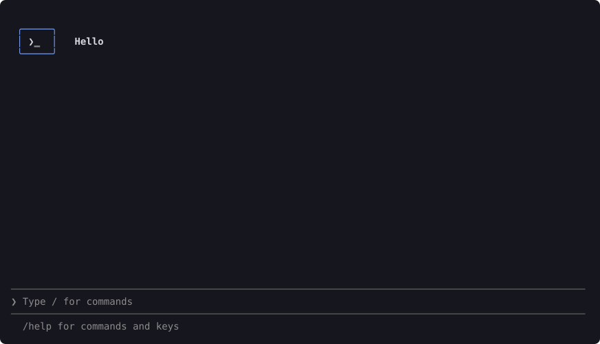
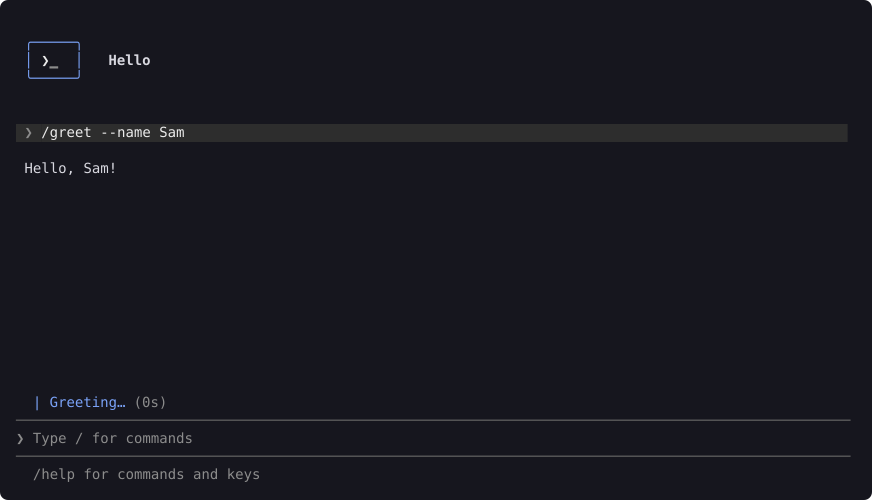
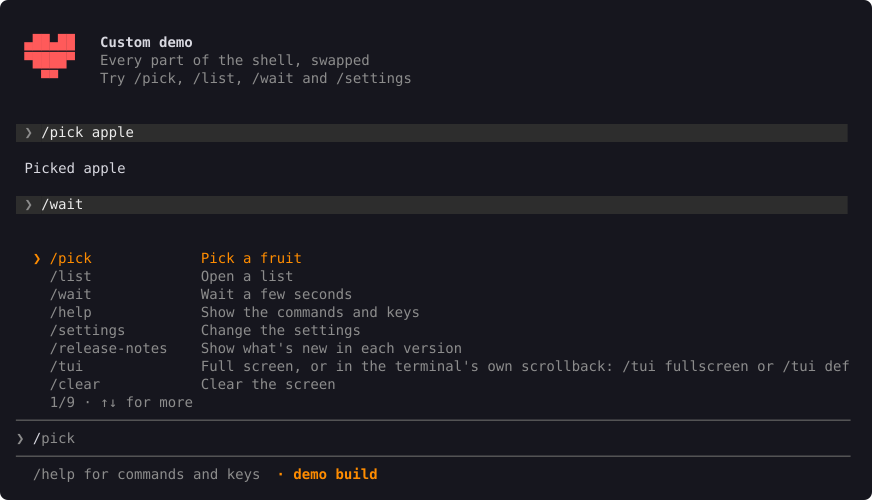
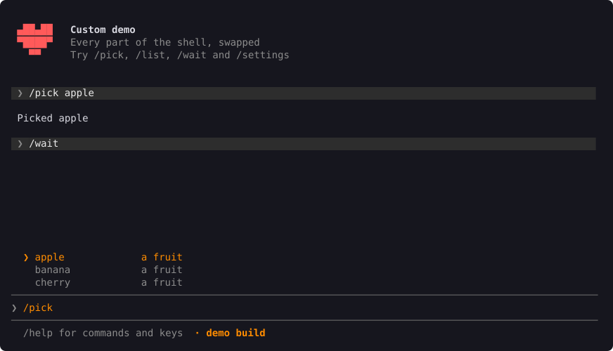

# Getting started

## Add it

shellkit isn't on crates.io yet. Add it from GitHub, with the [features](#features) you need:

```toml
[dependencies]
shellkit = { git = "https://github.com/Deaadman/shellkit", features = ["clap"] }
```

## Your app

Your app is one type that implements `App`. Two things are required: the list of commands, and what to do when someone sends a line.

```rust
use shellkit::{App, CommandInfo, Ctx, NoPanel, Shell, outln};

struct Hello;

impl App for Hello {
    type Msg = ();
    type Panel = NoPanel;

    fn commands(&self) -> Vec<CommandInfo> {
        vec![CommandInfo::new("greet", "Say hello").flag("--name", "Who to greet", Some("NAME"))]
    }

    fn run(&mut self, line: &str, ctx: &mut Ctx<Self>) {
        ctx.start("Greeting", || outln!("Hello!"));
    }
}

fn main() -> anyhow::Result<()> {
    Shell::new(Hello).title("Hello").run()
}
```

This is the `minimal` example. When it opens:



After `/greet --name Sam`:



## Commands

`CommandInfo::new(name, description)` is one command. Add `.flag(long, description, value)` for each of its flags; `value` is the name of what the flag takes, or `None` for a switch.

Typing `/` shows them all. Keep typing to filter the list, and press Tab to complete one.



If you use [clap](https://crates.io/crates/clap), turn on the `clap` feature and build the list from your parser: `CommandInfo::from_clap(&Cli::command())`.

To suggest values, like a file name or one of a few words, return a `Completer` from `App::completer`. The `custom` example suggests fruit after `/pick`:



## Running work

`run` should return quickly, so the screen keeps drawing. Put slow work on a thread with `ctx.start(label, work)`. The status bar shows the label, a spinner and the seconds so far. One command runs at a time; others wait their turn.

When the work finishes, what it returned goes to `App::done`. That's `App::Msg`: use `()` if there's nothing to hand back.

## Printing

Print with `outln!` and `errln!` instead of `println!` and `eprintln!`. Inside the shell they go to the screen; outside it, to the terminal as usual. So the code behind `/greet` can also run as `hello greet` from the command line, if your `main` handles arguments too.

For coloured pieces on one line, use `out::row(vec![(Kind::Good, "✓ ".into()), (Kind::Out, "Done".into())])`.

## What else your app can say

Everything else on `App` is optional:

| Method | What it's for |
| --- | --- |
| `done(msg, ctx)` | A command's thread finished |
| `launch(ctx)` | Once, when the shell opens |
| `tick(ctx)` | About every 80 ms: timers and background checks |
| `refresh()` | After a command or a settings change: read your state again |
| `header()` | The lines beside the logo |
| `notices()` | Messages on the right of the status bar, most important first |
| `footer()` | The line under the input box |
| `placeholder()` | The grey text in an empty input box |
| `completer()` | Values for the menu |
| `panel_event(e, ctx)` | What your own panel asked for |
| `crashed()` | What to say when a command's thread crashes |

`ctx` is how they ask the shell for things: `start`, `open` and `close_panel`, `open_help`, `open_settings`, `clear`, `exit`, `set_line` and `refresh`.

## Built-in commands

The shell adds these after yours:

| Command | What it does |
| --- | --- |
| `/help` | Your help, your commands and the keys |
| `/settings` | Your settings, when you give it some |
| `/release-notes` | What's new in each version, when you give it a changelog |
| `/tui` | Full screen, or in the terminal's own scrollback |
| `/clear` | Clear the screen |
| `/exit` | Quit (`/quit` works too) |

If your app has a command with one of these names, yours runs instead. See [Panels](panels.md).

## Keys

| Key | What it does |
| --- | --- |
| Enter | Run the line, or the highlighted command |
| Tab or → | Complete the highlighted suggestion |
| ↑ ↓ | Move in the menu, or go back through what you typed |
| Esc | Hide the menu, or close a panel |
| PgUp PgDn | Scroll the output |
| Ctrl+L | Clear the screen |
| Ctrl+C | Clear the line. Press it twice on an empty line to quit. |

`Shell::history(path)` keeps what was typed between sessions.

## Features

| Feature | What it adds |
| --- | --- |
| `clap` | The command list from a clap parser |
| `theme-file` | Colours from a TOML file |
| `files` | The data folder and settings files. See [Logs and files](logs-and-files.md). |
| `install` | Installing your app. See [Installing and updating](install-and-update.md). |
| `update` | Updates from GitHub releases, and the release templates |
