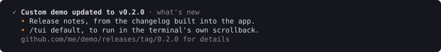

# Installing and updating

With the `install` and `update` features, Abalone can install your app, keep it updated from your GitHub releases, and tell people what's new.

## How people install your app

People run one line, and get the newest version on their PATH:

| System | They run |
| --- | --- |
| Windows | `irm https://raw.githubusercontent.com/me/my-app/main/install.ps1 \| iex` |
| macOS and Linux | `curl -fsSL https://raw.githubusercontent.com/me/my-app/main/install.sh \| bash` |

Each script downloads the build for that computer, checks it against the release's list of files and their SHA-256 hashes, adds the app to the PATH, and runs `my-app install`. On Arm Windows and Arm Macs, an x64 build is used when there isn't one of their own.

Abalone writes both scripts for you. Keep them in your repository, with a test that fails when they're out of date:

```rust
let scripts = InstallScript::new("My App", "my-app", "me/my-app");
std::fs::write("install.ps1", scripts.render())?;
std::fs::write("install.sh", scripts.render_sh())?;
```

`.about()` adds to the comment at the top, `.after()` and `.after_sh()` run more after installing, and `.done()` changes the last thing they say.

## Where it's installed

| System | Folder |
| --- | --- |
| Windows | `%LOCALAPPDATA%\my-app` |
| macOS | `~/Library/Application Support/my-app` |
| Linux | `~/.local/share/my-app` |

`$MY_APP_HOME` moves it. Inside are `versions`, with one folder per installed version, and `bin`, with the copy on the PATH.

Your app's `install` command does the copying:

```rust
let layout = install::Layout::new("my-app")?;
install::install(&layout, VERSION, &std::env::current_exe()?)?;
install::report(&layout, "My App", VERSION); // where it went, and how to add it to the PATH
```

## Updates

`Updater` checks your GitHub releases for a newer version. In the shell, it checks when the app opens and every few hours after, and installs the update in the background:

```rust
let updater = Updater::new("My App", "my-app", "me/my-app", VERSION, &data_dir)?;
Shell::new(app).update_check(Duration::from_secs(6 * 60 * 60), "/update", updater.background(|| auto_update_on()))
```

The status bar says when an update is ready, in green, and the next launch uses it. If automatic updates are off, it says one is available instead.


Your `update` command is one line: `updater.update_command()?`. It installs the newest version, or says this one is up to date.

`MY_APP_DISABLE_AUTOUPDATER=1` turns background updates off. `MY_APP_UPDATE_URL` gets updates from another address, for testing.

## What's new

The first time a new version runs, `updater.whats_new()` gives you its notes to show:



The notes come from your `CHANGELOG.md`. People can read every version's notes any time with `/release-notes`; see [Panels](panels.md#release-notes).

## Publishing a release

Abalone has templates for this too. Keep them in your repository and test that they're current, like the install scripts:

| Template | What it is |
| --- | --- |
| `release::Workflow::new("my-app", "my-app-cli").render()` | `.github/workflows/release.yml`: on a tag like `1.2.0`, builds for each system and publishes the release |
| `release::NOTES_SCRIPT` | `scripts/release-notes.ps1`: turns a version's section of `CHANGELOG.md` into the release's description and the in-app notes |

The workflow builds for Windows x64, Linux and macOS on x64 and Arm. `.platforms(&["windows-x64"])` builds fewer. Each release carries the builds and a `manifest.json` listing them, which the install scripts and the updater read.

To release:

1. Move the changes under `## [Unreleased]` in `CHANGELOG.md` to a new `## [1.2.0] - YYYY-MM-DD` section.
2. Set the version in `Cargo.toml` to match.
3. Push a tag with the same version, with no `v`: `git tag 1.2.0 && git push origin 1.2.0`.
