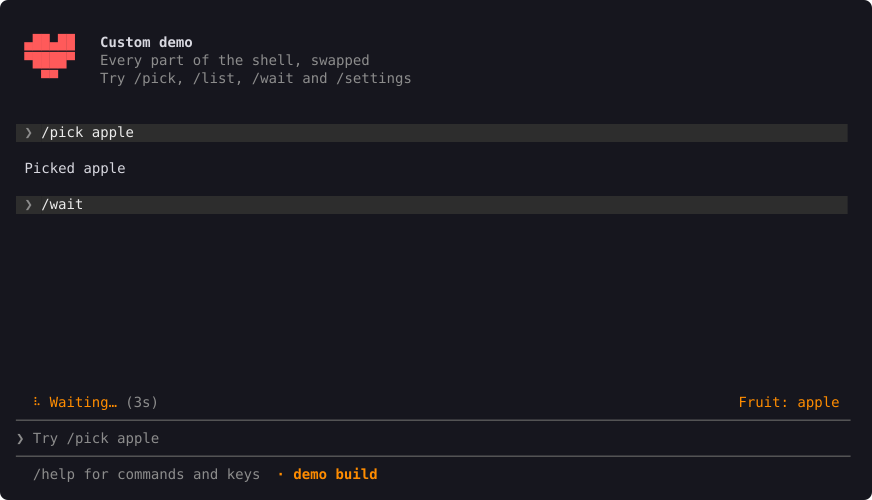
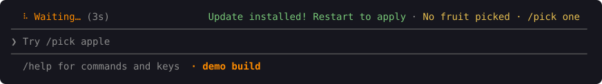

# Making it yours

Every part of the shell has a default. Change only what you want; the `custom` example changes all of it.



## Colours

A theme is nine colours, each with a job:

| Colour | Used for |
| --- | --- |
| `accent` | Titles, the selected item, the spinner's label |
| `bright` | Text that should stand out |
| `muted` | Hints and less important text |
| `rule` | The lines around the input box |
| `danger` | Errors |
| `warn` | Warnings |
| `good` | Good news, like an installed update |
| `echo_bg` | Behind a line you sent |
| `on_bright` | Text on a `bright` background, like the selected tab |

Start from the default and change what you like:

```rust
const MINE: Theme = Theme {
    accent: Color::Rgb { r: 255, g: 140, b: 0 },
    ..Theme::DEFAULT
};

Shell::new(app).theme(MINE)
```

To let people pick their own colours, turn on the `theme-file` feature and read a TOML file with `Theme::from_toml(text, Theme::DEFAULT)`. Each colour is written as `"#rrggbb"`, and any left out keep the default.

Your own panels can use the same colours with `abalone::theme()`.

### Light backgrounds

The colours are made for a dark background. When the terminal says its background is light (through `COLORFGBG`, or the classic Windows console's colours), the default theme darkens itself to read on it. Windows Terminal doesn't say, so give people a setting and call `abalone::set_light_background(true)` before the shell runs.

With a theme of your own, pass it through `for_terminal`, and colours your panels use directly through `abalone::readable`:

```rust
Shell::new(app).theme(MINE.for_terminal())

Style::fg(abalone::readable(MY_GREEN))
```

`Theme::on_light` gives the light version whatever the terminal says.

## Logo

The logo sits at the top left, beside your header lines. It can play a short animation when the shell opens. The default is a small terminal window.

| Logo | What it is |
| --- | --- |
| `DefaultLogo` | A terminal window with a blinking cursor |
| `TextLogo::text(include_str!("logo.txt"), style)` | Text drawn by hand, from a file |
| `PixelLogo` | Pixel art, one image per animation frame (the heart in the picture above) |
| `NoLogo` | No logo |

Or draw your own:

```rust
impl Logo for Mine {
    fn frames(&self) -> usize { 10 }               // frames in the opening animation
    fn rows(&self, frame: usize) -> Vec<Row> { … } // every row the same width
}

Shell::new(app).logo(Mine)
```

## Spinner

While a command runs, the status bar shows a spinner. The default turns through `| / - \`.

```rust
Shell::new(app).spinner(Frames::new(&["⠋", "⠙", "⠹", "⠸", "⠼", "⠴", "⠦", "⠧", "⠇", "⠏"]))
```

Any function from the time so far to a glyph works too: `|elapsed: Duration| (style, glyph)`.

## Header

`App::header` gives the lines beside the logo: your app's name, its version, what to try first. With none, the shell shows its title.

## Status bar

The left of the status bar shows the running command, or how far you've scrolled back. The right shows notices from `App::notices`, most important first. When the bar is too narrow, the least important are left off.



```rust
fn notices(&self) -> Vec<Notice> {
    vec![Notice::warn("Not set up yet · /settings")]
}
```

`Notice::warn`, `danger`, `info` and `good` use the theme's colours. Update notices come first; see [Installing and updating](install-and-update.md).

## Everything else

The header, the command menu, the input box, the lines around it, the status bar and the footer are each drawn by a method of `Skin`. Change one, and call the function of the same name to start from the default:

```rust
struct Tagged;

impl Skin for Tagged {
    fn footer(&self, text: &str, w: usize) -> Row {
        let mut row = skin::footer(text, w);
        row.push((Style::default().bold(), "  · beta".into()));
        row
    }
}

Shell::new(app).skin(Tagged)
```

The prompt (`❯ `), the title, how many suggestions the menu shows and how often the screen redraws are on `Shell` too: `.prompt()`, `.title()`, `.menu_rows()` and `.tick()`.
