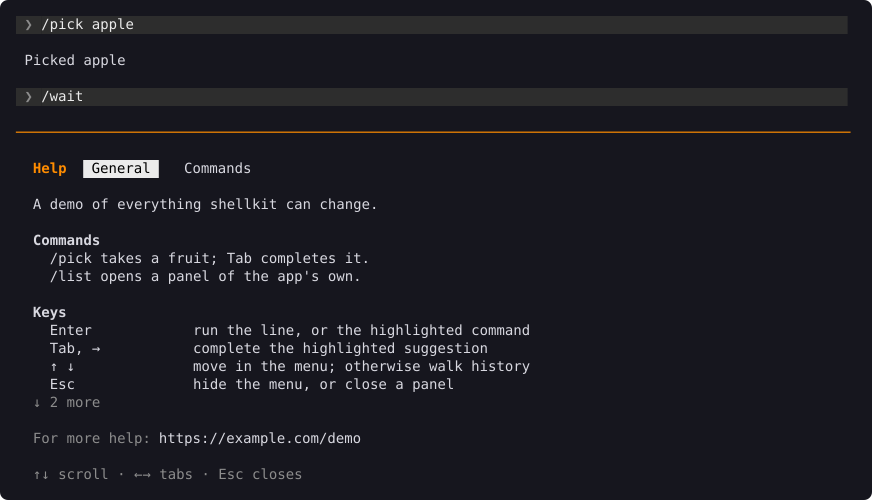
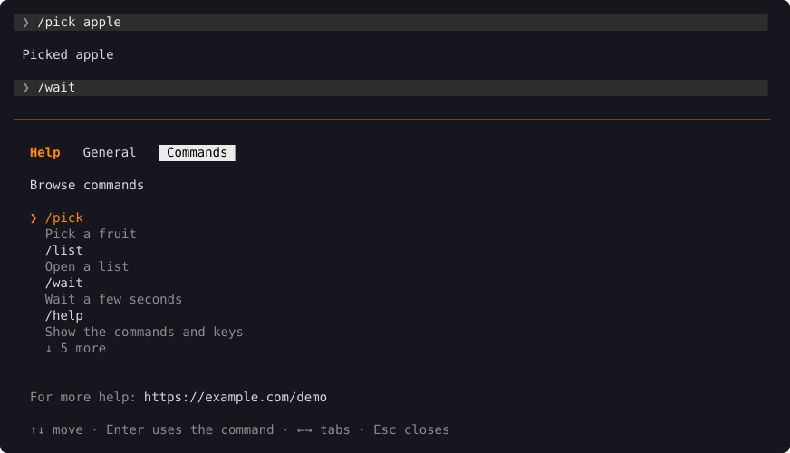
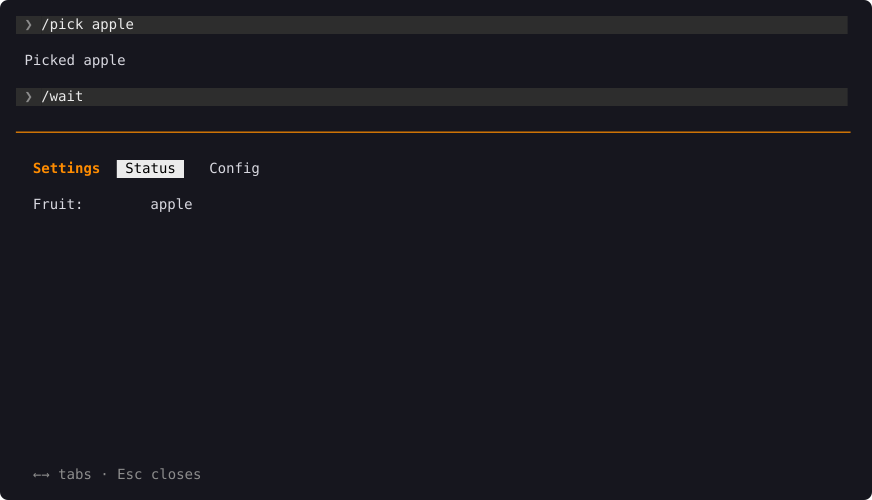
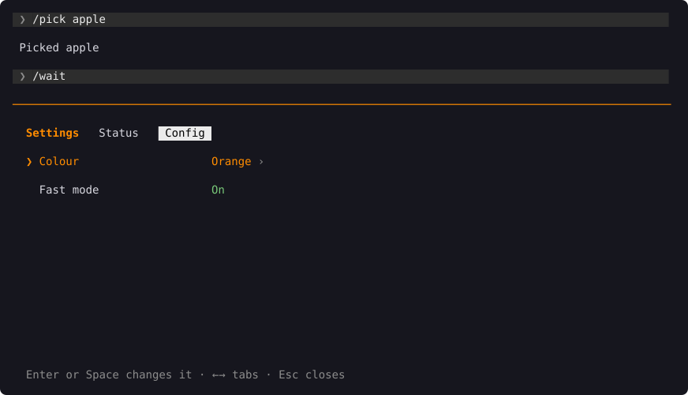
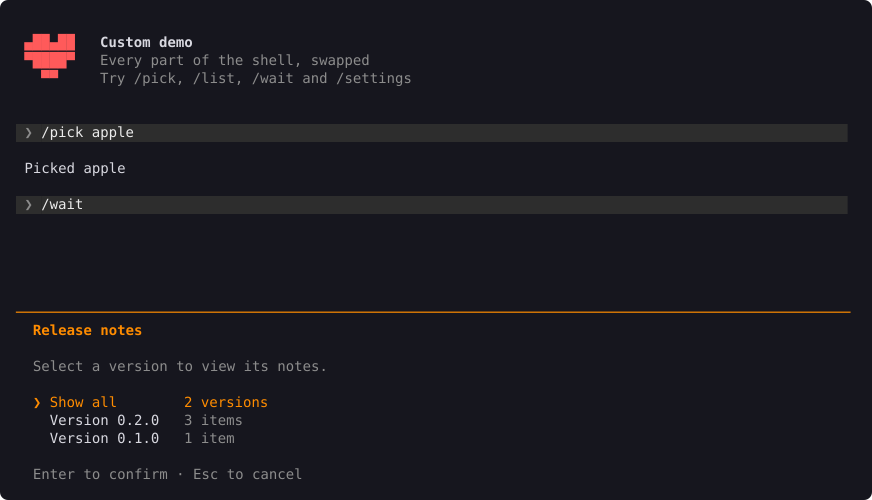
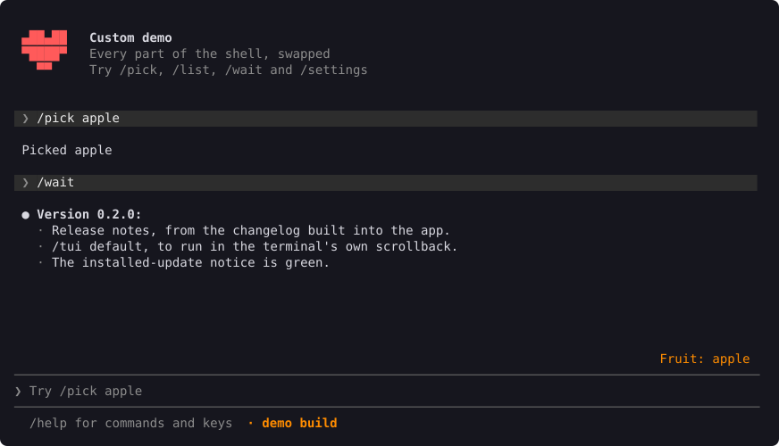
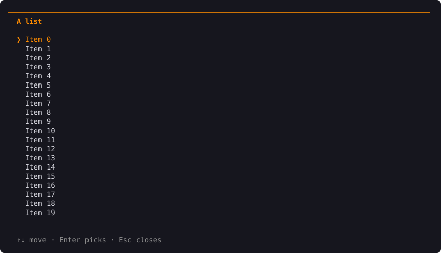

# Panels

A panel opens in place of the input box, with the output still above it, or covers the whole screen. Esc closes it. The shell has three of its own, and you can add yours.

## Help

`/help` has a tab of your own text, a tab of every command, and the keys. ← and → switch tabs.



```rust
let help = Help::new()
    .text("General", "What it does.\n\n# Getting started\n  /init sets it up.")
    .commands("Commands")
    .link("https://example.com/my-app")
    .issues("https://example.com/my-app/issues");

Shell::new(app).help(help)
```

A line starting with `# ` is a heading. The keys are added to the first text tab; `.without_keys()` leaves them out. The commands tab lists each command with its flags, and Enter puts the highlighted one in the input box.



`HelpTab::Custom` adds a tab of rows you draw yourself.

## Settings

`/settings` appears when you give the shell some settings. It has two tabs: Status, for things to read, and Config, for things to change.



For switches, choices and text, `SimpleSettings` is enough. Each setting reads and writes your own state:

```rust
Shell::new(app).settings(|| {
    SimpleSettings::new()
        .status("Version", || env!("CARGO_PKG_VERSION").into())
        .toggle("Automatic updates", get_auto, set_auto)
        .choice("Colour", colours, get_colour, set_colour)
        .gap()
        .secret("API key", get_key, set_key)
})
```



For settings that lead to one another, like picking a provider and then typing its key, or a list that loads in the background, implement `SettingsModel` instead. Each step says what comes next: a `Picker` (or `Picker::loading`), a text `Field`, `Changed`, or an `Error`.

To print the Status tab outside the shell, as a `my-app settings` command, use `settings::status_lines`.

## Release notes

`/release-notes` lists every version in your app's changelog with how many changes it has. Pick one, or **Show all**.



The notes print into the output:



```rust
Shell::new(app).release_notes(include_str!("../CHANGELOG.md"))
```

The changelog is built into your app, so the notes work offline and always match the version that's running. It follows [Keep a Changelog](https://keepachangelog.com/en/2.0.0/): a `## [1.2.0] - 2026-10-21` heading for each version, and `- ` lines under `### Added`, `### Fixed` and so on. The `[Unreleased]` section isn't shown.

## Your own panels

Implement `Panel`: what each key does, and the rows to draw. Open it from a command with `ctx.open(panel)`.



```rust
impl Panel for ListPanel {
    type Event = ListEvent;

    fn key(&mut self, key: KeyEvent) -> PanelEvent<ListEvent> {
        if widgets::is_close(&key) {
            return PanelEvent::Close;
        }
        // …move the selection, or return PanelEvent::Event(ListEvent::Chosen(i))
        PanelEvent::None
    }

    fn rows(&mut self, w: usize, h: usize) -> Vec<Row> {
        widgets::frame(w, h, widgets::title("A list"), None, body, "Enter picks · Esc closes")
    }
}
```

What the panel asks for goes to `App::panel_event`. A panel covers the whole screen unless its `full_screen` says `false`.

`widgets` has the pieces the built-in panels are made of: the frame, tabs, titles, paragraphs, labelled fields, bullets, numbered steps, selectable lists, scrolling, a text field, and the keys they share.

## Replacing a built-in

The shell only adds `/help`, `/settings`, `/release-notes`, `/tui`, `/clear` and `/exit` when your app has no command with that name. To replace one, list your own in `App::commands` and handle it in `App::run`. `Shell::without_help()` drops `/help` altogether.

## Full screen or inline

The shell draws one of two ways, and `/tui` switches between them:

| | `/tui fullscreen` (the default) | `/tui default` |
| --- | --- | --- |
| Where | The whole terminal, on a screen of its own | Below what was already in the terminal |
| Output | Scrolls with PgUp and PgDn | Stays in the terminal's own scrollback |
| When you quit | The terminal looks as it did before | The output stays; only the input box goes |

Inline, panels that cover the whole screen still open on a screen of their own while they're up.

`Shell::tui(Tui::Inline)` starts inline, and `Shell::tui_file(path)` remembers the choice between sessions.
